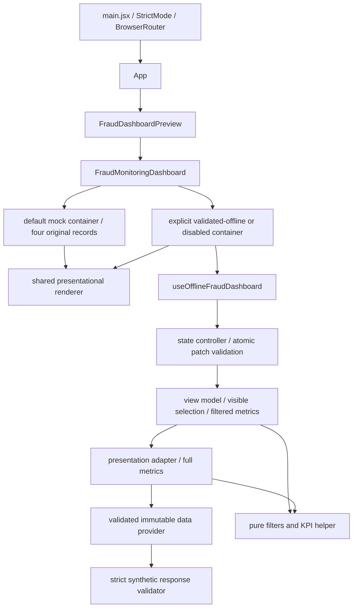
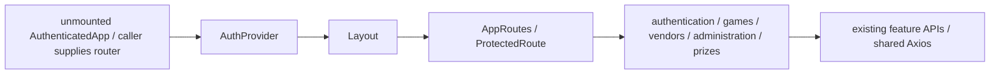

# Architecture and ownership

Frontend is React 19/Vite with separate application composition and feature modules. Backend is Express 5/CommonJS/Mongoose 9 with feature-local controllers/services/models/routes. Dependencies and build configuration remain unchanged. Do not create empty target folders merely to match a diagram.



The import graph contains offline helpers but no live fraud-report transport or authentication/API clients. Explicit `report` data alone never changes modes. Unknown mode/invalid input fails closed; replacement object identity resets controls and selected details. Mock search is unrestricted and mock hidden selections restore when filters return; validated search has a 200-character limit and hidden selections clear permanently. Do not accidentally unify these behaviors.



This future boundary is not imported by main or App. Keep it that way until separately authorized. Tokens persist in localStorage only inside this inactive authenticated tree.

```mermaid
flowchart LR
  Express[server.js / CORS / Helmet / body limits] --> DB[lazy /api database middleware]
  DB --> AuthR[/api/auth]
  DB --> GamesR[/api/games]
  DB --> SpinR[/api/spin]
  DB --> VendorR[/api/vendor]
  DB --> AdminR[/api/admin]
  GamesR --> Game[server-owned sessions and game services]
  Game --> Assessment[integrity V2 / advisory behavior V1]
  Game --> Decision[preliminary prize decisions]
  Decision --> Recovery[claims / retries / reconciliation]
  AdminR --> Review[administrator review / audit fence]
  VendorR --> Redemption[guarded redemption / vendor fence]
  Disabled[allocation service: hardcoded false]
```

Core ownership: authentication owns User and OTP/JWT guards; games owns GameSession/Spin and gameplay; prizes owns inventory/awards/decisions/recovery/redemption; fraud-monitoring owns independent assessments/report shaping; vendors owns Vendor and scan/dashboard interfaces; administration owns AdminUser/AdminAuditLog and administrative orchestration. Email is infrastructure and must not initialize in offline tests. Shared policy remains server/config/gameConfig.js.

Runtime imports and unused source are different: the experimental reporting controller has no mounted router; legacy spinService can write/send but is not used by mounted spin mutations. Historical backups have stale imports and must not be activated. See MODULE_INVENTORY.json and API_REFERENCE.md for exact declarations.
