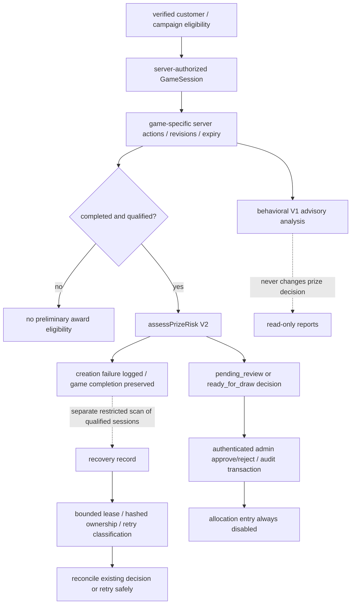

# Fraud, decision and recovery lifecycle

Safety invariants: one award per user/campaign; one decision/recovery per game session; one award per originating session or legacy spin; claim ownership and token-version fences rechecked within relevant transactions. Schema declarations and code paths do not prove deployed indexes or concurrency correctness.

The completion callback catches preliminary-decision failures and returns a failure result without undoing the completed game. It does not automatically enqueue a durable job. Recovery record discovery/creation and worker execution are separate restricted operations; no worker was run during this work.

`prizeAllocationService` contains `const ALLOCATION_ENABLED = false` and rejects before allocation writes. Preserve it even when documenting future activation. Legacy spin mutations return disabled responses; the unused legacy spin service still has QR/email behavior and must not be reconnected.

`prizeRedemptionService` and admin review are real transactional implementations, not offline simulations. Invoke only with synthetic adapters until a separately authorized sandbox phase. No QR dispatch, customer notifications, prize allocation or production data is part of development verification.

The automatic SMTP verification previously performed at mailer import has been removed. This does not disable explicit email methods or authorize exercising them; use mocks in offline tests.

The dashboard is observational. Integrity findings and behavior signals remain separate arrays/flags/versions. Presentation full-collection KPIs differ from view-model filtered KPIs; overlapping warning counts are independent, not an enforcement score. Experimental backend reporting remains unregistered.
