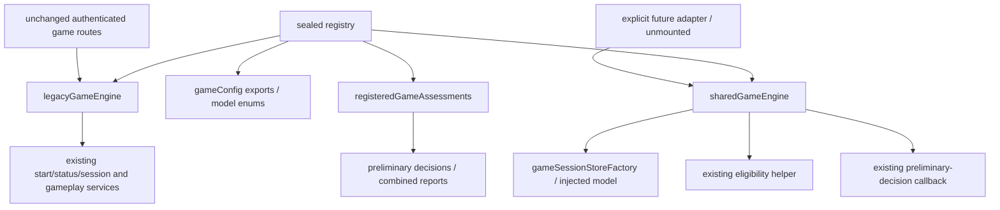

# Shared game architecture and developer contract

Phase B implements a sealed registry, compatibility adapters and a reusable verified-evidence lifecycle. Production registrations remain **Monkey and Perfect Shot only**. Spin stays disabled/unregistered. The synthetic proof game exists only in server/tests/unit/helpers/syntheticGame.cjs; it is deliberately trivial and must never become a customer game.



## Compatibility

Existing routes/status codes/response shapes, scoring, credentials and CAS behavior are preserved. Generic legacy completion remains abandon/finish-without-qualification, never client-score submission. gameConfig keeps its four exports and exactly the existing configuration values/order; version/capabilities are registry metadata, not extra legacy API fields. Original scoring services and schema files were not rewritten.

Future verified-evidence registrations cannot use the legacy start/session/history/abandon adapter. Registration alone does not activate a future HTTP game or silently select the wrong state machine. Only two legacy registrations currently exist.

## Adding a future game

1. Add a server validator module under features/games/validators (or its game-owned folder), exporting the synchronous pure handlers below. First add deterministic positive/negative/timing/replay tests. A React component is not proof of a supported game.
2. Add a static reviewed definition and id to registry/gameRegistry.js definitions/approvedGameIds. There is no runtime register method, request-based registration, environment discovery or folder scanning. Choose execution `verified-evidence` and a positive version.
3. Provide config id/label/maxAttempts/sessionTtlMs and explicitly validated game-specific fields. validateConfig must return exactly true and reject unknown/malformed fields. Current schema supports 1–3 attempts; larger policies require schema/migration review. TTL is bounded to 1–86,400,000 ms. Legacy Monkey v1 is pinned to seven hits/twenty rounds to match its service rules.
4. Compose createPersistentGameEngine explicitly with the registry, existing GameSession model, gameStartService.checkCustomerEligibility, gameCompletionDecisionService.processQualifiedCompletion, server clock and a server signing key of at least 32 characters. No model/DB/dotenv/mail dependency is implicitly imported by this factory, and no key/environment value was created or read during this phase.
5. When separately authorized to expose a future game, add a thin HTTP adapter using existing authentication. Build actor.userId from String(req.user._id) and campaignId from server policy, never request JSON. Delegate to shared operations; do not rewrite authentication/session/fraud/prize infrastructure or reuse the legacy abandon endpoint. No such adapter/route was mounted here.
6. Add the frontend interface and mocked UI/API tests. Update API/contract docs and explicit activation review. The offline dashboard contract still has its two existing game ids; extending that contract is separately reviewed and never enables live transport.

Illustrative registration shape (not enabled):

```js
{
  id: 'new-game', version: 1, execution: 'verified-evidence',
  preliminaryDecisions: true,
  config: { id: 'new-game', label: 'New game', maxAttempts: 3, sessionTtlMs: 120000 },
  actions: ['play'], limits: { maxEvidenceBytes: 4096, maxEvents: 40 },
  handlers: require('../validators/newGameValidator')
}
```

## Validation contract

| Handler | Input | Required result |
|---|---|---|
| validateConfig | Frozen config | Exactly true; validate all game-specific fields. |
| initialize | {config, now} | JSON server-owned initial state. |
| validateEvidence | {action, evidence, config} | Sanitized JSON; reject malformed/unknown action data. |
| apply | {state, action, evidence, now, config} | {state, completed:boolean}; transition from trusted state/evidence. |
| verify | {state, config, now} | {score:nonnegative safe integer, qualified:boolean}; recompute from server-verified evidence, never browser totals. |
| present | {state, config, now} | Safe public JSON progress; never credentials/private proof material/raw state wholesale. |
| assessIntegrity | Canonical session | {assessmentVersion:2, reviewRequired:boolean, riskReasons:string[]}. |
| assessBehavior | Canonical session | {behaviorVersion:1, reviewSuggested:boolean, signals:string[], enforcementAllowed:false}. |

Handlers are bounded synchronous server code with no I/O, mutation, hidden global state, email or prize actions. Use supplied server time and server-owned challenges/evidence. Registration validation cannot prove a plugin's scoring/anti-cheat logic is correct; individual review remains required. Legacy registry verify intentionally retains its observational assessment signature and cannot run through the new transition engine.

## Shared lifecycle and store

createGameEngine exposes discover/start/submit/complete/status/history/report; complete aliases verified submission. Actor/campaign are trusted adapter inputs. Discovery returns immutable metadata without functions.

Submission permits only sessionId/sessionToken/commandId/revision/action/evidence. IDs are cryptographic 24-hex server values. HMAC credentials bind id/user/campaign/game/config version and match a stored hash. Ownership/game/campaign are rechecked after reads. Client score/outcome/qualified/prize fields are forbidden. JSON validation rejects prototype keys, accessors, cycles, sparse arrays, nonfinite values and excessive depth/bytes. Evidence is at most 16 KiB; events at most 100; the immutable session envelope additionally has a 16 KiB limit, which may be reached earlier.

Start checks existing eligibility, resumes or creates an attempt, expires prior sessions and uses existing unique indexes to enforce attempt/active-session constraints. Completed/expired/cancelled attempts remain consumed. Deployed index installation and actual race behavior remain unverified.

Submit checks expiry/eligibility/revision, validates evidence and server score, and conditionally commits. Latest identical retries return the stored receipt, including completed retries after TTL. Changed-content command reuse and older processed identifiers fail closed. Concurrent different commands have one CAS winner; request revision participates in the replay digest.

gameSessionStoreFactory stores engineVersion/configVersion/revision/pluginState/lastCommand/assessments/decisionPending inside existing Mixed gameState. Its single guarded completion update also saves bounded evidence/audit events and the pending decision marker. Queries scope user/campaign/game/id and require active status, unexpired time and matching revision/config version. No schema/index changes were made.

Only committed qualified results invoke the existing preliminary-decision callback. Failures preserve completed gameplay and a bounded error/pending marker. Failed bookkeeping leaves the original durable marker intact. Existing restricted recovery can discover qualified sessions without decisions; worker lease/retry execution and pending-marker reconciliation remain separately unverified. A pending marker does not prove an active worker. No allocation, QR issuance or email is performed by this engine.

Assessment dispatch normalizes persisted Mixed state for future handlers. Both gameplay and decision/report dispatch reject configuration-version mismatch. Keep a version stable until sessions drain, or review a historical-version resolver/migration first; no historical resolver is implemented here. Integrity V2 controls preliminary review; Behavioral V1 remains independently advisory.

## Safe verification and remaining dependencies

From root: `node tools/run-offline-unit-tests.cjs` and `node tools/run-offline-assessments.cjs`. Fixed reviewed allowlists use empty inherited environment, permissions and capability guards; synthetic model operations are memory-only. No real Mongoose module loads.

From client: `npx vitest run src --environment jsdom`, then `npm run build`. Regenerate static evidence with `node tools/audit-project.cjs` and `node tools/verify-offline-structure.cjs`.

Real MongoDB casting/index/transaction/concurrency, HTTP integration, recovery execution and campaign capacity remain unverified. Database work needs separate named-sandbox approval; production database test is prohibited. Allocation remains false, experimental reporting unregistered and the mock dashboard remains the active application.
